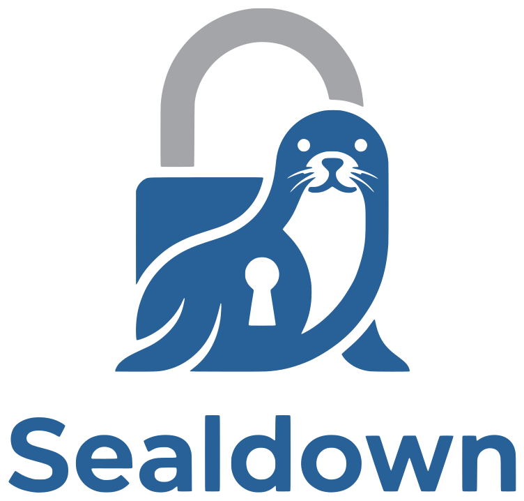

<p align="center">
  <picture>
    <source media="(prefers-color-scheme: dark)" srcset="public/sealdown-logo/sealdown-logo-white.svg">
    
  </picture>
</p>

# Sealdown

Share Markdown or JSON in a sealed link. Write or paste a document with Mermaid diagrams, math and
code, or a JSON document, then seal it: it is encrypted in your browser, optionally with a password, and only the people
with the link can open it. No account, and no server ever sees the document.
Live at https://trainedloop.github.io/sealdown/.

## Features

- **Write, Split and Read** modes, with the preview following the editor's scroll both ways.
- A CodeMirror editor with line numbers, a formatting toolbar (Ctrl/Cmd+B, Ctrl/Cmd+I), Mermaid
  errors underlined as you type (with plain-language hints for the common ones), an **Insert
  diagram** picker with a thumbnail of every diagram type, and **Open** (or drop a `.md` file).
- **Seal link**: every link is encrypted; a password, typed next to the button, protects it
  further. The seal dialog copies the link, says what protects it and shows a QR code.
- Reading: a sheet with contents on the left, GitHub-style callouts, front matter, footnotes,
  emoji shortcodes, copy buttons on code, diagrams you can expand, copy or download (SVG, PNG),
  **Present** for `---`-separated slides, export to PDF or `.md`, and **Edit a copy**.
- **JSON mode** (`#/json`, from the Markdown | JSON switch in the header), built on
  [vanilla-jsoneditor](https://github.com/josdejong/svelte-jsoneditor): text with validation on the
  left and a synchronized tree on the right, in Write, Split and Read like Markdown (Split scrolls
  both panes together, value by value), with format, compact, sort, repair and transform. Open or drop a `.json` file, export `.json`, and seal it the same way;
  a JSON link opens as a read-only tree with **Edit a copy**. The library loads only on JSON pages.
- **Live documents** (Share to edit): an edit link and a read link to one document that several
  people keep up to date. Sharing moves your tab into the document.
  - **Markdown** is edited in real time ([Yjs](https://yjs.dev)): everyone types at once, each letter
    arrives as it is typed, with the others' cursors and names, and nothing ever conflicts. Edits
    travel over a Supabase Realtime broadcast, encrypted with the document key and signed with a key
    derived from the edit token (Ed25519; readers hold only the public key), so a read link follows
    along but cannot write. Edits made offline are sent when the connection returns. The current
    state is saved a couple of seconds after typing stops (Ctrl/Cmd+S saves at once).
  - **JSON** saves after a short pause and merges what others saved, by path, with what you are
    typing; only changes both sides made to the same value wait for you to choose.
  - **History**: a checkpoint every 5 minutes of editing and when editing goes quiet for 2, listing
    everyone who edited; the newest 50 are kept. **Mark version** names the current text, and named
    versions are never removed. Any version can be compared and restored for everyone from the edit
    link; the read link can browse them.
  Still encrypted in the browser, with no accounts.
- Text styles (Modern, Editorial, Technical), dark and light themes, English and Portuguese, and a
  command palette (Ctrl/Cmd+K).

## How links work

| Link | Content |
|---|---|
| `#/s/<id>.<key>` | Every document: encrypted in the browser with AES-GCM (a 128-bit key) and stored in Supabase; the link carries the id and the key, so it is always short. |
| `#/q/<id>` | Password-protected: stored in Supabase, no key in the link. |
| `#/e/<ciphertext>.<key>` | Fallback when storage can't be reached (and the only kind in a build without Supabase): small documents (up to 4 KB encoded) travel in the link, ciphertext and key both in it. |
| `#/p/<ciphertext>` | The same fallback with a password: the ciphertext in the link, no key. |
| `#/w/<id>.<key>.<token>` | Live document, edit link: stored versions encrypted with `key`; `token` lets the browser save. The server keeps only the token's SHA-256. |
| `#/l/<id>.<key>` | Live document, read link: the edit link without the token. Always the latest version. |
| `#/n/<id>.<token>` | Password-protected live document, edit link: the key is derived from the password (PBKDF2, a public per-document salt kept in Supabase), so the link has none. |
| `#/m/<id>` | Password-protected live document, read link. After the password, the derived key is kept for that tab only (sessionStorage). |
| `#/v/<payload>` | Legacy plaintext links from before Sealdown encrypted everything: still opened, never created. |

Links made before keep working: their 256-bit keys and tokens still open, and so do older inline links.

A JSON document starts with an invisible marker (`\u0001json\n`) before it is compressed and
encrypted, so the link doesn't reveal the type and Markdown links are exactly what they always were.

Protected documents use a key derived from the password with PBKDF2-SHA256 (600 000 iterations,
random salt) and AES-GCM; neither the password nor the key is in the link. Stored protected
documents are fetched once, and password attempts happen in the browser.

Everything after `#` stays in the browser; it is never sent to a server. Supabase only ever sees
ciphertext and cannot read stored documents. Stored documents never expire on a timer: when they
exceed Sealdown's 100 MB budget, the least recently opened ones are removed first (a live document
counts with its current state and all its versions, and goes whole). Creating or saving runs that cleanup right away when
needed, besides the hourly job.

The Supabase project is shared with other small projects, so everything Sealdown owns lives in the
`sealdown` schema. Add `sealdown` to the project's exposed schemas (Settings → API → Exposed
schemas). Avoid `supabase config push`: it would overwrite settings other projects rely on.

## Metrics and privacy

Usage metrics go to PostHog (the same project as danielporto-site), loaded after the page is idle:
no cookies or storage, no autocapture and **no session recording**, since
recordings would capture documents. The URL fragment holds documents and keys, so a `before_send`
hook cuts every URL in an event to origin + path. Pageviews (for Web Analytics) are sent once per kind
of page with a `route` property, so every document counts as the same page. Nothing is sent with Do Not Track or Global
Privacy Control on, or when `VITE_POSTHOG_KEY` is missing. PostHog also drops events from
automated browsers.

Every event carries `app: sealdown`, `lang` and `route` (the kind of page it happened on: editor,
json-editor, inline-sealed, …). Events on a page showing a document also carry `doc_type` (markdown,
json); on a shared link that is known once the document is unsealed.

| Event | Properties |
|---|---|
| `$pageview` | `route`: editor, json-editor, live-edit, live-read, live-edit-protected, live-read-protected, inline-sealed, inline (legacy), stored, protected, error |
| `app_opened` | `route` (first page of the visit) |
| `link_created` | `result`, `storage`, `protected`, `size_kb`, `diagram_count` and `diagram_types` (Markdown only) |
| `link_opened` | `storage`, `protected`, `ok`, `error` |
| `password_failed` | — |
| `export` | `format`: pdf, md, json, svg, png |
| `file_opened` | `via`: picker, drop |
| `diagram_inserted` | `type` |
| `present_started` | `slides` |
| `qr_shown` | — |
| `mode_changed` | `mode`: write, split, read |
| `format_applied` | `format` (toolbar button id) |
| `code_copied` | — |
| `diagram_expanded` | — |
| `diagram_copied` | `ok` |
| `typeset_changed` | `style` |
| `command_run` | `command` (command id) |
| `live_created` | `protected` |
| `live_opened` | `access`: edit, read; `realtime` (Markdown) |
| `version_saved` | JSON only: `merged`, `conflicts` (count); sent for merged saves and the first save of a visit, not every autosave |
| `conflict_resolved` | `conflicts` (count) |
| `version_restored` | — |
| `versions_viewed` | — |
| `version_named` | — (never the name) |
| `collab_peers` | `max`: the most other people present at once, sent when the page is left |

## Development

Requires Node (LTS), pnpm and Docker.

```sh
pnpm install
pnpm dev                # app at http://localhost:5173 (no Supabase: large documents fall back to long links)
pnpm test               # unit tests
pnpm db:start           # local Supabase in Docker, then apply migrations
pnpm db:reset           # wipe the local database and re-apply migrations
pnpm db:test            # database tests (pgTAP)
pnpm test:e2e           # end-to-end tests (Playwright in its Docker image)
pnpm test:e2e:stored    # end-to-end tests against the local Supabase
pnpm test:visual        # visual regression for every diagram type
```

To run the app against the local database, put the `API_URL` and `PUBLISHABLE_KEY` from
`pnpm exec supabase status` into `.env.local` as `VITE_SUPABASE_URL` and `VITE_SUPABASE_ANON_KEY`.

## Database migrations

The Supabase project is shared with other projects, and the Supabase CLI keeps a single migration
history per database. So sealdown uses [dbmate](https://github.com/amacneil/dbmate) instead, with
its history in `sealdown.schema_migrations`: each project tracks only its own migrations and never
blocks another.

- Migrations live in `db/migrations` as plain SQL with `-- migrate:up` / `-- migrate:down` sections.
  Create one with `pnpm db:migrate local new <name>`.
- Locally, `pnpm db:start` and `pnpm db:reset` apply them. `supabase/seed.sql` only creates the empty
  schema so the local API can start before dbmate runs.
- In production, apply pending migrations with the session pooler URI from the dashboard
  (Connect → Session pooler). Put it in `.env.local`, which git ignores and Vite never exposes:

  ```sh
  # .env.local
  DATABASE_URL=postgresql://postgres.<ref>:<password>@<pooler-host>:5432/postgres?sslmode=require
  ```

  Then `pnpm db:migrate` (or `pnpm db:migrate status`).

## Keeping Mermaid current

Dependency updates are manual for now (an automated agent may take this over later). To update
Mermaid:

```sh
pnpm up mermaid @mermaid-js/mermaid-zenuml --latest
pnpm test:visual
pnpm thumbs
```

`src/templates/diagrams.md` holds one example of every diagram type; the visual tests compare
their screenshots with the approved baselines. Review any image diffs in the Playwright report,
then refresh the baselines:

```sh
pnpm test:visual --update-snapshots
```

When Mermaid adds a diagram type, add an example under its own `##` heading in
`src/templates/diagrams.md` and refresh the baselines. The editor's picker uses the same examples;
regenerate its thumbnails (`public/diagram-thumbs`) with `pnpm thumbs` whenever the examples or
Mermaid change. Keep examples deterministic (for instance,
give `gitGraph` commits explicit ids). The Playwright Docker image tag follows `@playwright/test`,
so updating Playwright also changes screenshots.

## Deployment

Pushes to `main` deploy to GitHub Pages once CI passes. The repository needs the variables
`SUPABASE_URL` and `SUPABASE_ANON_KEY` (the project's publishable key, which is public by design).
The `keepalive` workflow pings Supabase every three days so the free-tier project doesn't pause.

## Formerly rendermd

Sealdown was called rendermd until 2026-10-15. The repository `TrainedLoop/rendermd` only redirects
links shared under the old address (keeping the document after `#`), browsers move their saved
draft and settings to the new names on the first visit, and `db/one-off/2026-10-15-rename-schema.sql`
moved the database schema.
