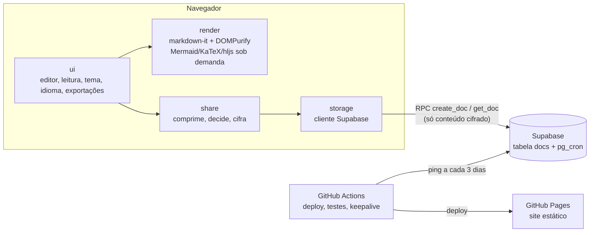

# rendermd — Design

- **Data:** 2026-10-14
- **Status:** aguardando revisão
- **URL prevista:** `https://trainedloop.github.io/rendermd/`

## 1. Contexto e objetivo

Problema real que originou o projeto: renderizar um `.md` com diagramas Mermaid e mandar para outra pessoa **um link do documento já renderizado**. As opções existentes (Gist, HackMD, Notion) exigem conta, guardam o conteúdo em claro no servidor de terceiros, mostram a interface da plataforma e usam versões antigas do Mermaid, então tipos de diagrama recentes não renderizam.

O rendermd é uma **ferramenta de uso real** (o portfólio vem como consequência): colar ou digitar Markdown, ver o resultado e compartilhar um link, sem conta e sem atrito.

### Critérios de sucesso

1. Do colar ao link copiado em poucos segundos, sem login.
2. Todo tipo de diagrama suportado pela versão mais recente do Mermaid renderiza.
3. Quem recebe o link vê uma página limpa, legível em claro e escuro, no celular e no desktop.
4. Nenhum conteúdo chega legível a um servidor.
5. Custo de operação zero (GitHub Pages + plano gratuito do Supabase + GitHub Actions em repo público).

## 2. Escopo

### Dentro da v1

- Editor único (colar ou digitar) com alternador **Código | Preview**; rascunho salvo no navegador.
- Gerar link: documento pequeno inteiro na URL; documento grande cifrado no navegador e salvo no Supabase.
- Página de leitura limpa com botão **Editar uma cópia**.
- Tema claro/escuro (segue o sistema, com botão para trocar; inclui os diagramas).
- Exportar PDF (impressão do navegador com CSS de impressão).
- Baixar cada diagrama como SVG ou PNG.
- Baixar o `.md` original.
- Sumário automático a partir dos títulos.
- Destaque de sintaxe em blocos de código.
- Fórmulas matemáticas (KaTeX).
- Interface em português e inglês.
- Limpeza automática do banco (menos acessados primeiro) e cron para o Supabase não pausar.
- Renovate + testes visuais para manter o Mermaid atualizado.

### Fora da v1

- Agente de IA abrindo PRs (adiado por custo).
- Contas, login, edição do documento original.
- Prazo de expiração escolhido por quem cria; link de exclusão.
- Domínio próprio.
- Upload arrastando arquivo (colar cobre o caso; pode entrar depois).
- Rate limit de criação (exigiria backend próprio).

## 3. Stack

Mesma stack do `danielporto-site`:

- React 19, Vite, TypeScript, pnpm, i18next/react-i18next, oxlint.
- Markdown: **markdown-it** com plugins para âncoras de título, listas de tarefas, tabelas GFM e KaTeX.
- Destaque de sintaxe: highlight.js, com linguagens carregadas sob demanda.
- Diagramas: **mermaid**, sempre na versão mais recente.
- Sanitização: **DOMPurify**.
- Banco: **Supabase** (Postgres) com `pg_cron`.
- Testes: Vitest, Supabase CLI (banco local em Docker), Playwright (ponta a ponta e visual).
- CI/CD: GitHub Actions, Renovate, GitHub Pages.

Abordagens descartadas: unified/remark (flexibilidade que o projeto não usa, mais lento e com mais peças) e TypeScript sem framework (o peso que importa é o do Mermaid, não o do React; a UI ficaria manual).

## 4. Arquitetura



### 4.1 Rotas

Site de página única; todo o estado de rota fica no fragmento (`#`), que nunca é enviado a servidor.

| Rota | Conteúdo |
|---|---|
| `#/` | Editor |
| `#/v/<payload>` | Leitura de documento pequeno; `payload` = texto comprimido (deflate-raw) em base64url |
| `#/s/<id>.<chave>` | Leitura de documento grande; `id` do registro no Supabase, `chave` AES-GCM em base64url |

Os prefixos `v` e `s` identificam a versão do formato. Uma mudança futura de codificação ganha prefixo novo, e os decodificadores antigos continuam existindo.

**Âncoras de título:** como o `#` é usado pelo roteamento, os links do sumário **não** alteram o hash; a rolagem é feita por JavaScript (`scrollIntoView`). Links internos do próprio Markdown (`[x](#titulo)`) recebem o mesmo tratamento.

### 4.2 Módulos

Cada módulo tem uma responsabilidade e uma interface pequena, testável isoladamente.

- **`render`**: `renderMarkdown(texto) → HTML seguro` e `hydrate(container, tema)`, que encontra blocos Mermaid, KaTeX e código, carrega a biblioteca necessária só se houver bloco daquele tipo, e renderiza. Mermaid roda com `securityLevel: 'strict'`. A configuração do DOMPurify permite a marcação gerada pelo KaTeX e o SVG gerado pelo Mermaid, e nada além do necessário.
- **`share`**: `createLink(texto) → url` e `openLink(hash) → texto`. Contém o codec (compressão + base64url), a criptografia (AES-GCM de 256 bits, IV aleatório por documento, via Web Crypto) e a regra de decisão.
- **`storage`**: único módulo que conhece o Supabase. `save(cifrado) → id` e `load(id) → cifrado | null`. URL e chave pública do Supabase vêm de variáveis de build (`VITE_SUPABASE_URL`, `VITE_SUPABASE_ANON_KEY`); a chave pública não é segredo.
- **`ui`**: telas de editor e leitura, alternador Código | Preview, tema, idioma, sumário, exportações e mensagens de erro.

### 4.3 Banco (Supabase)

```sql
create table docs (
  id               text primary key,         -- 10 caracteres aleatórios base62
  content          bytea not null,            -- IV + conteúdo comprimido e cifrado
  created_at       timestamptz not null default now(),
  last_accessed_at timestamptz not null default now(),
  constraint content_max_1mb check (octet_length(content) <= 1048576)
);

alter table docs enable row level security;  -- sem nenhuma policy: acesso direto bloqueado
```

O acesso acontece **somente** por funções `security definer`, expostas como RPC:

- `create_doc(content bytea) → text`: gera o id, insere e devolve o id.
- `get_doc(id text) → bytea`: devolve o conteúdo e atualiza `last_accessed_at`; devolve nulo se não existir.
- `ping() → int`: consulta trivial usada pelo keepalive.

Ninguém lista, edita ou apaga pela API.

**Limpeza:** `prune_docs()` roda de hora em hora via `pg_cron`. Ordena por `last_accessed_at` decrescente, soma o tamanho acumulado e apaga tudo que passar de **400 MB**. O teto fica abaixo dos ~500 MB do plano gratuito porque o espaço de um `DELETE` é reaproveitado pelo autovacuum, mas não devolvido ao disco na hora. (Limites do plano gratuito a confirmar na implementação.)

## 5. Fluxo de dados

### 5.1 Criar e compartilhar

1. O usuário cola ou digita no editor. O texto é salvo como rascunho no `localStorage` (com `try/catch`; a falha não bloqueia nada).
2. A aba Preview renderiza localmente, sem rede.
3. **Gerar link:** o texto é comprimido (deflate-raw, `CompressionStream`) e codificado em base64url.
   - **Até 4 KB codificado:** link `#/v/<payload>`.
   - **Acima:** gera chave AES-GCM aleatória, cifra o conteúdo comprimido, chama `create_doc` e monta `#/s/<id>.<chave>`.
4. O link é copiado para a área de transferência, com confirmação visual.

### 5.2 Abrir um link

1. O roteador lê o hash.
2. `v`: decodifica, descomprime e renderiza.
3. `s`: chama `get_doc(id)`, decifra com a chave, descomprime e renderiza.
4. A página de leitura mostra o documento, o sumário (quando há 3 ou mais títulos), tema, exportações e **Editar uma cópia**.

### 5.3 Editar uma cópia

O conteúdo vai para o editor como rascunho novo. Gerar link cria um documento novo; o original nunca muda.

### 5.4 Versão do Mermaid

O documento é sempre renderizado com o Mermaid da versão **atual** do site. Links antigos ganham suporte a diagramas novos e correções automaticamente.

## 6. Tratamento de erros

Princípio: um problema localizado não derruba a página, e toda mensagem diz o que fazer.

### Ao abrir um link

| Situação | Comportamento |
|---|---|
| Falha ao decodificar, descomprimir ou decifrar | "Este link parece incompleto. Apps de mensagem às vezes cortam links longos; peça para quem enviou gerar de novo." |
| `get_doc` devolve nulo | "Este documento expirou. Documentos grandes pouco acessados são removidos quando o espaço enche." |
| Erro de rede ou Supabase fora do ar | "Não foi possível carregar o documento agora", com **Tentar de novo** |
| Prefixo desconhecido | "Este link foi criado por uma versão mais nova do rendermd. Recarregue a página." |

### Ao gerar o link

| Situação | Comportamento |
|---|---|
| Supabase fora do ar | Aviso e oferta do link longo `#/v/` (com a ressalva de que alguns apps cortam links longos) |
| Conteúdo cifrado acima de 1 MB | Aviso antes de enviar; sugere **Baixar .md** ou **Exportar PDF** |
| Área de transferência bloqueada | Link exibido num campo selecionável |

### Dentro do documento

- **Erro de sintaxe Mermaid:** caixa com a mensagem do Mermaid e o código do bloco; o resto renderiza.
- **Fórmula KaTeX inválida:** fórmula exibida como texto em vermelho (`throwOnError: false`).
- **Falha ao carregar Mermaid, KaTeX ou highlight.js:** o bloco mostra o código cru com **Tentar de novo**.
- **HTML perigoso:** removido silenciosamente pelo DOMPurify.

Todos os textos de interface ficam nos arquivos de idioma (pt e en).

## 7. Testes

### 7.1 Unitários (Vitest)

- Codec: ida e volta preserva o texto exato (acentos, emoji, documentos grandes).
- Criptografia: ida e volta funciona; conteúdo adulterado ou chave errada falha explicitamente.
- Decisão: abaixo de 4 KB gera `v`, acima gera `s`.
- Roteador: cada formato é interpretado corretamente; entradas malformadas caem no erro certo.
- Sanitização: bateria de vetores XSS (`<script>`, `onerror`, `javascript:` em links, SVG malicioso, ataques via rótulos Mermaid) sai inofensiva.

### 7.2 Banco (Supabase CLI local)

- Acesso direto à tabela negado; `create_doc` e `get_doc` funcionam.
- Conteúdo acima de 1 MB rejeitado.
- `get_doc` atualiza `last_accessed_at`.
- `prune_docs` apaga primeiro os menos acessados e para abaixo do teto (teste com teto reduzido).

### 7.3 Ponta a ponta (Playwright)

- Documento pequeno: colar, gerar link, abrir em nova aba, ver renderizado.
- Documento grande: mesmo fluxo pelo Supabase local.
- Editar uma cópia gera link novo e preserva o original.
- Erros: link cortado, documento inexistente, Supabase fora do ar com fallback.

### 7.4 Visuais (Playwright)

- Documento de referência com **um exemplo de cada tipo de diagrama Mermaid**, KaTeX, blocos de código e tabelas.
- Screenshot por bloco, em claro e escuro, comparado com a versão aprovada.
- Ao surgir um tipo de diagrama novo, o exemplo é adicionado manualmente.

## 8. CI/CD e operação

| Workflow | Gatilho | O que faz |
|---|---|---|
| `ci` | Toda PR e push | Lint, tipos, unitários, banco, ponta a ponta e visuais |
| `deploy` | Push na `main` com CI verde | Build e publicação no GitHub Pages |
| `keepalive` | Cron a cada 3 dias | Chama `ping()` no Supabase; reativa o próprio workflow agendado pela API do GitHub (`PUT /repos/{owner}/{repo}/actions/workflows/{id}/enable`) para não ser desativado após 60 dias sem atividade no repo. Plano B se a permissão falhar: commit vazio mensal num branch `keepalive`. Falha gera e-mail do GitHub. |
| Renovate | Versões novas de dependências | Abre PR; a CI roda os testes visuais |

## 9. Riscos e questões em aberto

- **Spam no banco:** sem backend não há rate limit. Mitigado pelo limite de 1 MB e pela limpeza automática; um Worker com rate limit entra se virar problema.
- **Limites do plano gratuito do Supabase** (tamanho, regra de pausa e o que conta como atividade): confirmar no início da implementação.
- **Peso do Mermaid:** carregado só quando o documento tem diagrama; a página de leitura sem diagramas fica leve.
