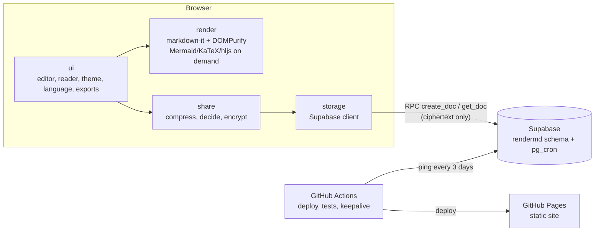

# rendermd — Design

- **Date:** 2026-10-14
- **Status:** approved
- **Planned URL:** `https://trainedloop.github.io/rendermd/`

## 1. Context and goal

The real problem behind the project: render a `.md` file with Mermaid diagrams and send someone **a link to the rendered document**. Existing options (Gist, HackMD, Notion) require an account, store the content in plaintext on a third-party server, show the platform's UI, and ship old Mermaid versions, so recent diagram types don't render.

rendermd is a **tool for real use** (the portfolio value comes as a consequence): paste or type Markdown, see the result, and share a link, with no account and no friction.

### Success criteria

1. From paste to copied link in a few seconds, no login.
2. Every diagram type supported by the latest Mermaid release renders.
3. The recipient sees a clean page, readable in light and dark, on phone and desktop.
4. No content reaches any server in readable form.
5. Zero running cost (GitHub Pages + Supabase free tier + GitHub Actions on a public repo).

## 2. Scope

### In v1

- Single editor (paste or type) with a **Code | Preview** toggle; draft saved in the browser.
- Generate link: small documents live entirely in the URL; large documents are encrypted in the browser and stored in Supabase.
- Clean reading page with an **Edit a copy** button.
- Light/dark theme (follows the system, with a toggle; applies to diagrams too).
- Export PDF (browser print with a print stylesheet).
- Download each diagram as SVG or PNG.
- Download the original `.md`.
- Automatic table of contents from headings.
- Syntax highlighting in code blocks.
- Math (KaTeX).
- UI in English by default, with Portuguese available from the language toggle (the choice is remembered).
- Automatic database cleanup (least recently accessed first) and a cron to keep Supabase from pausing.
- Visual tests to keep Mermaid updates safe (updates are manual for now; an automated agent may handle them later).

### Out of v1

- AI agent opening PRs (postponed due to cost).
- Accounts, login, editing the original document.
- Creator-chosen expiration; delete links.
- Custom domain.
- Drag-and-drop file upload (pasting covers the use case; may come later).
- Creation rate limiting (would require a backend of our own).

## 3. Stack

Same stack as `danielporto-site`:

- React 19, Vite, TypeScript, pnpm, i18next/react-i18next, oxlint.
- Markdown: **markdown-it** with plugins for heading anchors, task lists, GFM tables and KaTeX.
- Syntax highlighting: highlight.js, with languages loaded on demand.
- Diagrams: **mermaid**, always on the latest release.
- Sanitization: **DOMPurify**.
- Database: **Supabase** (Postgres) with `pg_cron`.
- Tests: Vitest, Supabase CLI (local database in Docker), Playwright (end-to-end and visual).
- CI/CD: GitHub Actions, Renovate, GitHub Pages.

Rejected approaches: unified/remark (flexibility the project doesn't use, slower, more moving parts) and framework-free TypeScript (the weight that matters is Mermaid's, not React's; the UI would be hand-rolled).

## 4. Architecture



### 4.1 Routes

Single-page site; all route state lives in the fragment (`#`), which is never sent to a server.

| Route | Content |
|---|---|
| `#/` | Editor |
| `#/v/<payload>` | Small document reader; `payload` = text compressed with deflate-raw, base64url-encoded |
| `#/s/<id>.<key>` | Large document reader; `id` of the Supabase record, `key` = AES-GCM key in base64url |

The `v` and `s` prefixes identify the format version. A future encoding change gets a new prefix, and the old decoders stay.

**Heading anchors:** since `#` is used for routing, table of contents links do **not** change the hash; scrolling is done in JavaScript (`scrollIntoView`). In-document Markdown links (`[x](#heading)`) get the same treatment.

### 4.2 Modules

Each module has one responsibility and a small interface, testable in isolation.

- **`render`**: `renderMarkdown(text) → safe HTML` and `hydrate(container, theme)`, which finds Mermaid, KaTeX and code blocks, loads each library only if a block of that kind exists, and renders. Mermaid runs with `securityLevel: 'strict'`. The DOMPurify config allows the markup KaTeX produces and the SVG Mermaid produces, and nothing beyond what is needed.
- **`share`**: `createLink(text) → url` and `openLink(hash) → text`. Holds the codec (compression + base64url), the encryption (256-bit AES-GCM, random IV per document, via Web Crypto) and the decision rule.
- **`storage`**: the only module that knows about Supabase. `save(ciphertext) → id` and `load(id) → ciphertext | null`. Supabase URL and public key come from build variables (`VITE_SUPABASE_URL`, `VITE_SUPABASE_ANON_KEY`); the public key is not a secret.
- **`ui`**: editor and reader screens, Code | Preview toggle, theme, language, table of contents, exports and error messages.

### 4.3 Database (Supabase)

The Supabase project, and its ~500 MB free-tier database, is shared with other small projects, each in its own schema. Everything rendermd owns lives in the `rendermd` schema, which must be listed in the project's exposed API schemas; requests select it with the `Content-Profile: rendermd` header.

```sql
create table rendermd.docs (
  id               text primary key,         -- 10 random base62 characters
  content          bytea not null,            -- IV + compressed, encrypted content
  created_at       timestamptz not null default now(),
  last_accessed_at timestamptz not null default now(),
  constraint content_max_1mb check (octet_length(content) <= 1048576)
);

alter table rendermd.docs enable row level security;  -- no policies: direct access blocked
```

Access happens **only** through `security definer` functions, exposed as RPC:

- `create_doc(content text) → text`: takes the encrypted bytes as standard base64, generates the id, inserts and returns the id. Refuses (error `53100`) when the whole database exceeds ~450 MB, so a burst between prunes can't make the shared database read-only; clients then fall back to the long link.
- `get_doc(doc_id text) → text`: returns the content as standard base64 and updates `last_accessed_at`; returns null if it doesn't exist.
- `ping() → int`: trivial query used by the keepalive.

Nobody can list, edit or delete through the API.

**Migrations:** plain SQL in `db/migrations`, applied with dbmate. Its history table is `rendermd.schema_migrations`, because the Supabase CLI keeps one history per database and other projects share it.

**Cleanup:** `prune_docs()` runs hourly via `pg_cron` (job `rendermd-prune-docs`). It orders by `last_accessed_at` descending, sums the running size and deletes everything past rendermd's budget of **100 MB**, leaving the rest of the shared database to other projects. Space freed by `DELETE` is reused by autovacuum but not returned to disk immediately.

## 5. Data flow

### 5.1 Create and share

1. The user pastes or types in the editor. The text is saved as a draft in `localStorage` (wrapped in `try/catch`; failure blocks nothing).
2. The Preview tab renders locally, with no network.
3. **Generate link:** the text is compressed (deflate-raw, `CompressionStream`) and base64url-encoded.
   - **Up to 4 KB encoded:** link `#/v/<payload>`.
   - **Above:** generate a random AES-GCM key, encrypt the compressed content, call `create_doc` and build `#/s/<id>.<key>`.
4. The link is copied to the clipboard, with visual confirmation.

### 5.2 Open a link

1. The router reads the hash.
2. `v`: decode, decompress and render.
3. `s`: call `get_doc(id)`, decrypt with the key, decompress and render.
4. The reader page shows the document, the table of contents (when there are 3 or more headings), theme, exports and **Edit a copy**.

### 5.3 Edit a copy

The content goes into the editor as a new draft. Generating a link creates a new document; the original never changes.

### 5.4 Mermaid version

Documents are always rendered with the site's **current** Mermaid version. Old links pick up new diagram types and fixes automatically.

## 6. Error handling

Principle: a local problem never takes down the page, and every message says what to do next.

### Opening a link

| Situation | Behavior |
|---|---|
| Decode, decompress or decrypt fails | "This link looks incomplete. Messaging apps sometimes cut long links; ask the sender to generate it again." |
| `get_doc` returns null | "This document has expired. Large, rarely accessed documents are removed when space runs out." |
| Network error or Supabase down | "Couldn't load the document right now", with **Try again** |
| Unknown prefix | "This link was created by a newer version of rendermd. Reload the page." |

### Generating a link

| Situation | Behavior |
|---|---|
| Supabase down | Warning plus an offer of the long `#/v/` link (noting some apps cut long links) |
| Encrypted content over 1 MB | Warning before sending; suggests **Download .md** or **Export PDF** |
| Clipboard blocked | Link shown in a selectable field |

### Inside the document

- **Mermaid syntax error:** a box with Mermaid's error message and the block's source; the rest renders.
- **Invalid KaTeX formula:** formula shown as red text (`throwOnError: false`).
- **Failure loading Mermaid, KaTeX or highlight.js:** the block shows raw source with **Try again**.
- **Dangerous HTML:** silently removed by DOMPurify.

All UI strings live in the locale files (pt and en).

## 7. Testing

### 7.1 Unit (Vitest)

- Codec: round trip preserves the exact text (accents, emoji, large documents).
- Crypto: round trip works; tampered content or wrong key fails explicitly.
- Decision: under 4 KB produces `v`, above produces `s`.
- Router: each format is parsed correctly; malformed input lands on the right error.
- Sanitization: a battery of XSS vectors (`<script>`, `onerror`, `javascript:` links, malicious SVG, attacks via Mermaid labels) comes out harmless.

### 7.2 Database (local Supabase CLI)

- Direct table access denied; `create_doc` and `get_doc` work.
- Content over 1 MB rejected.
- `get_doc` updates `last_accessed_at`.
- `prune_docs` deletes least recently accessed first and stops below the cap (tested with a reduced cap).

### 7.3 End-to-end (Playwright)

- Small document: paste, generate link, open in a new tab, see it rendered.
- Large document: same flow through local Supabase.
- Edit a copy generates a new link and preserves the original.
- Errors: truncated link, missing document, Supabase down with fallback.

### 7.4 Visual (Playwright)

- Reference document with **one example of each Mermaid diagram type**, plus KaTeX, code blocks and tables.
- Screenshot per block, in light and dark, compared with the approved baseline.
- When a new diagram type ships, its example is added by hand.

## 8. CI/CD and operations

| Workflow | Trigger | What it does |
|---|---|---|
| `ci` | Every PR and push | Lint, types, unit, database, end-to-end and visual |
| `deploy` | Push to `main` with green CI | Build and publish to GitHub Pages |
| `keepalive` | Cron every 3 days | Calls `ping()` on Supabase; re-enables its own scheduled workflow via the GitHub API (`PUT /repos/{owner}/{repo}/actions/workflows/{id}/enable`) so it isn't disabled after 60 days without repo activity. Fallback if the permission fails: monthly empty commit on a `keepalive` branch. Failure triggers a GitHub email. |

## 9. Risks and open questions

- **Database spam:** without a backend there is no rate limit. Mitigated by the 1 MB cap and automatic cleanup; a Worker with rate limiting comes in if it becomes a problem.
- **Supabase free-tier limits** (size, pause rule and what counts as activity): confirm at the start of implementation.
- **Mermaid weight:** loaded only when the document has diagrams; reader pages without diagrams stay light.
