# Rendering reference

One example per Mermaid diagram type, plus math, code and tables. Used by the visual regression tests.

## flowchart

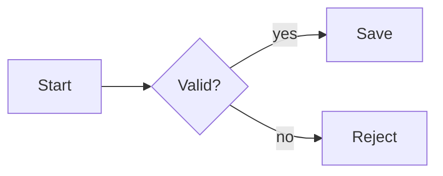

## sequence

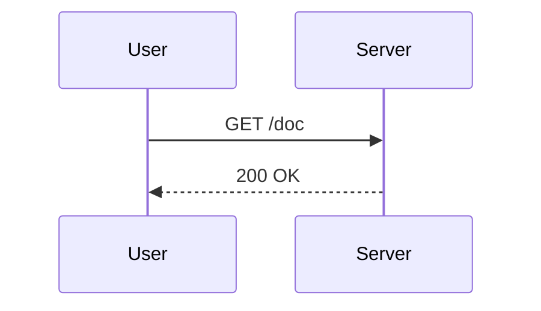

## class

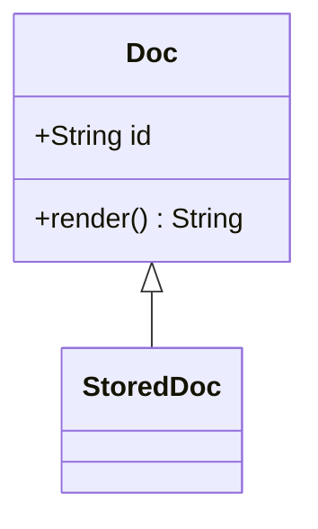

## state

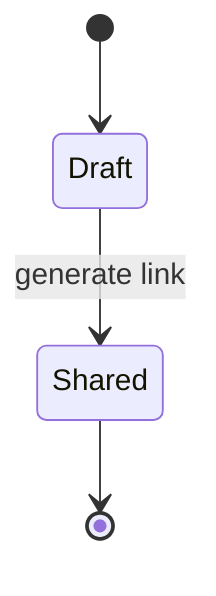

## er

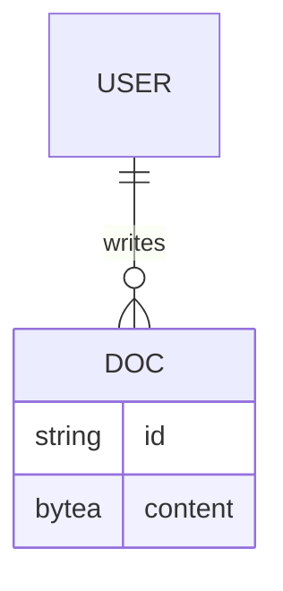

## user journey

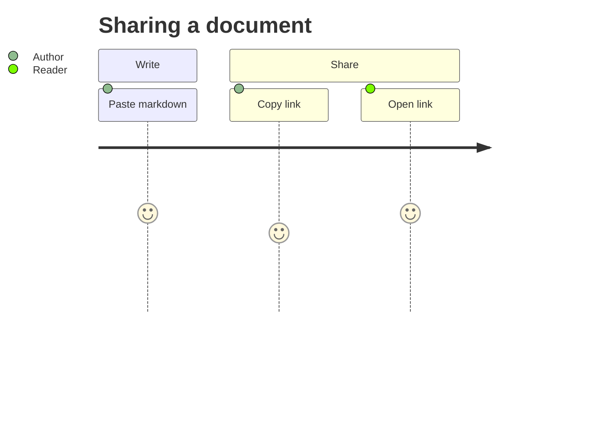

## gantt

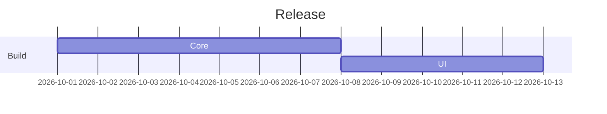

## pie

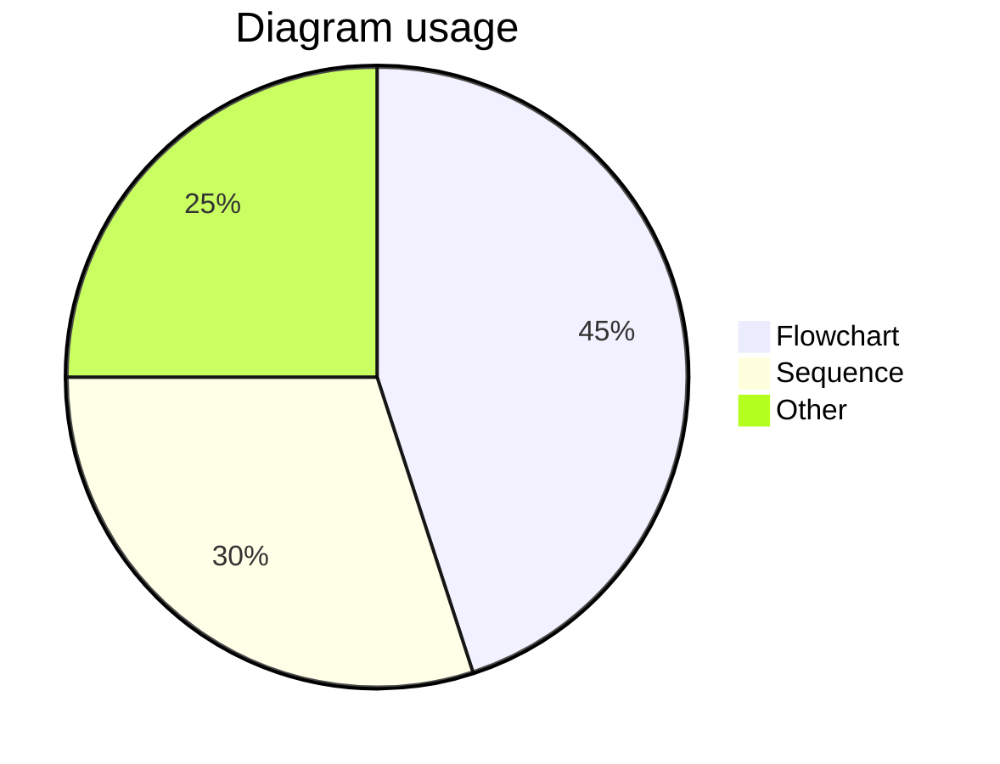

## quadrant

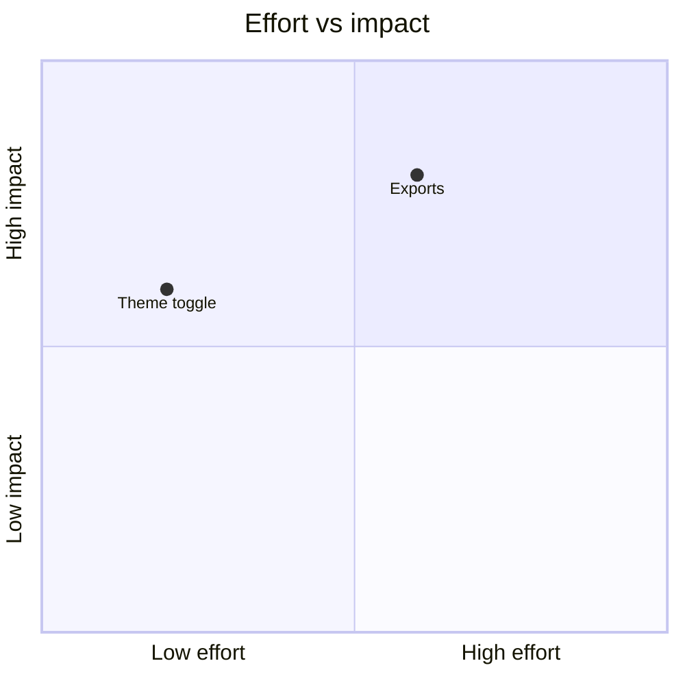

## requirement

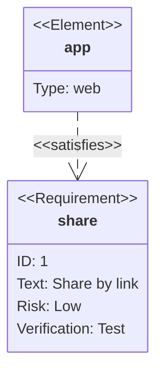

## gitgraph

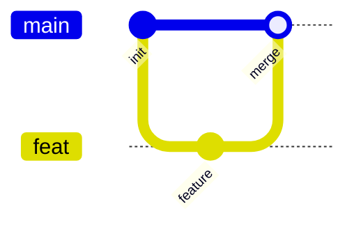

## c4

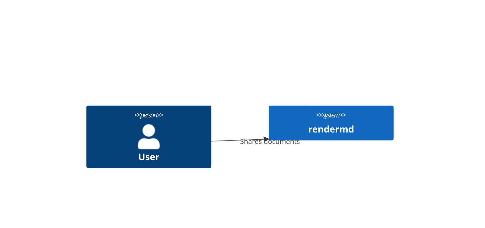

## mindmap

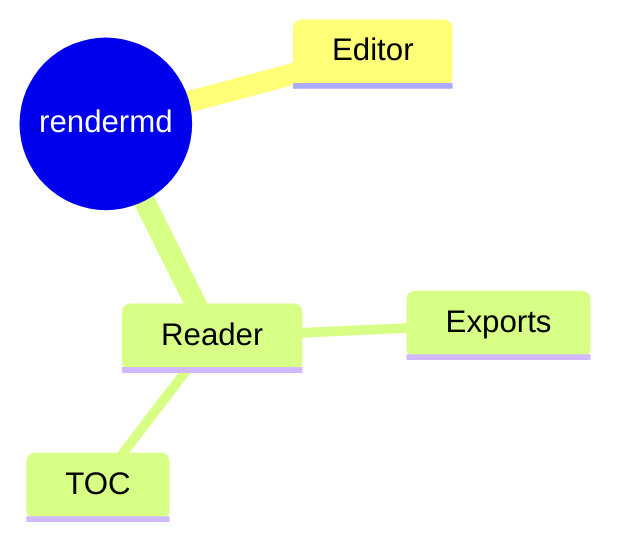

## timeline

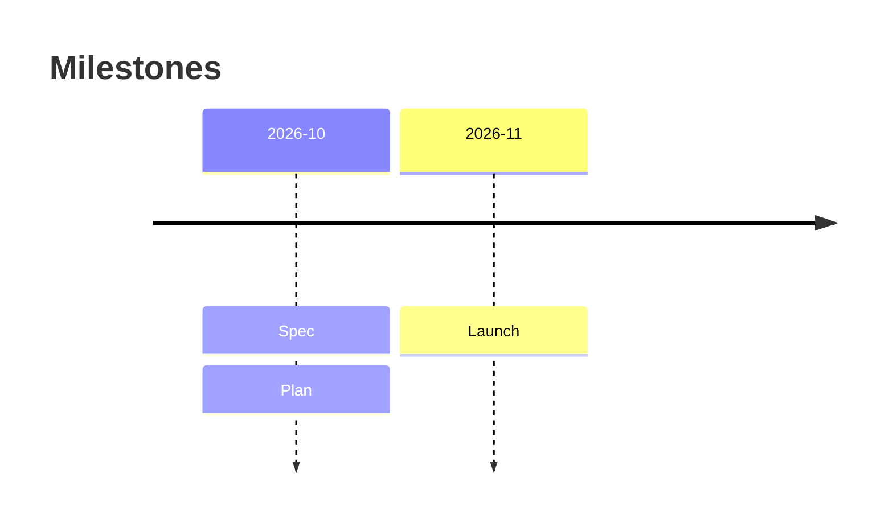

## zenuml

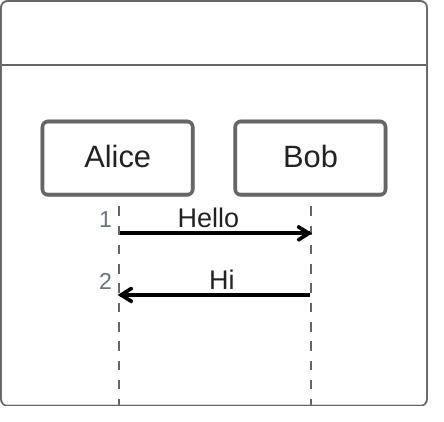

## sankey

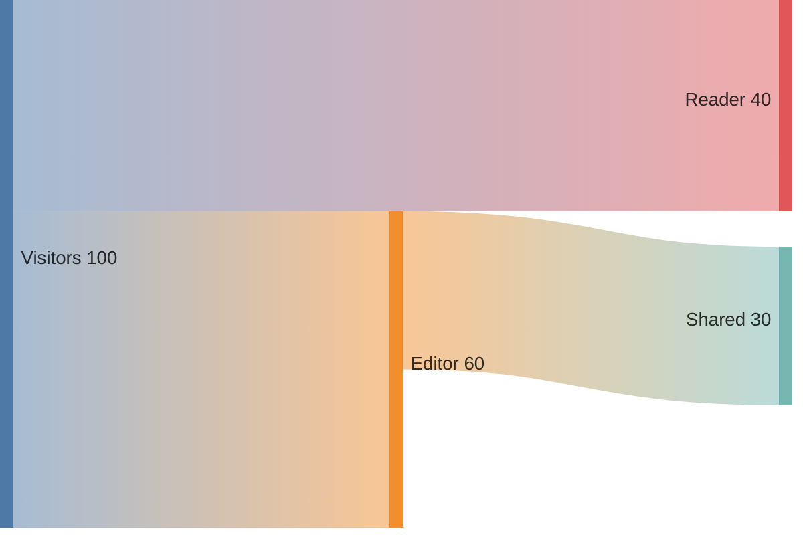

## xychart

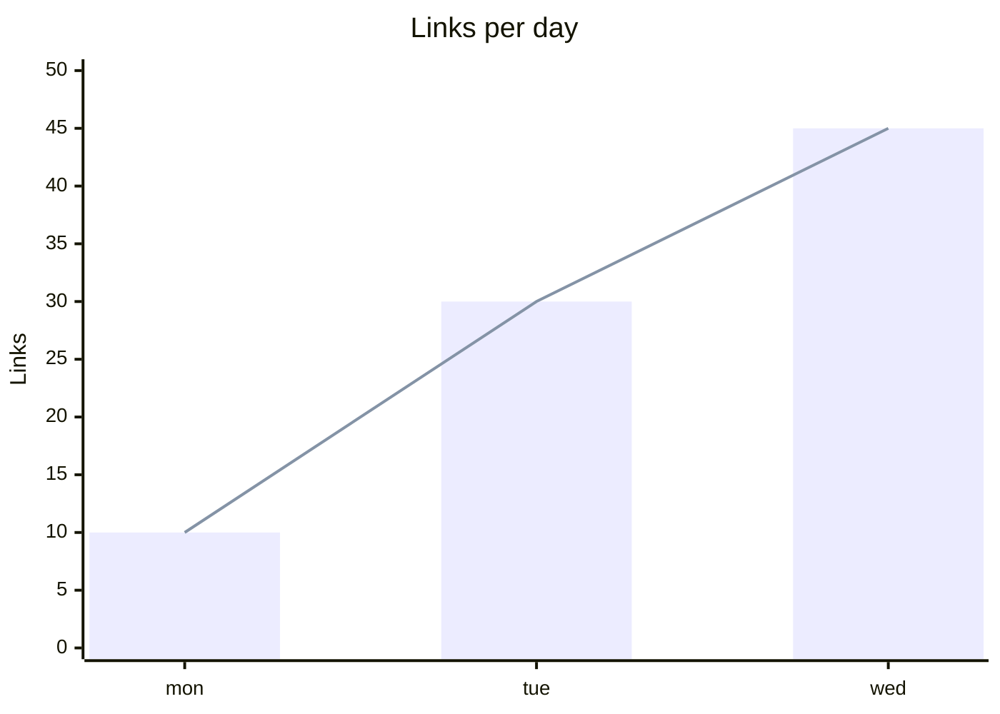

## block

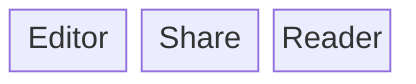

## packet

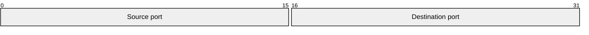

## kanban

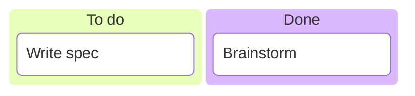

## architecture

```mermaid
architecture-beta
  group site(cloud)[Site]
  service web(internet)[Pages] in site
  service db(database)[Supabase]
  web:R --> L:db
```

## radar

```mermaid
radar-beta
  axis a["Speed"], b["Privacy"], c["Cost"]
  curve r["rendermd"]{4, 5, 5}
  max 5
```

## treemap

```mermaid
treemap
"Bundle"
    "App": 30
    "Mermaid": 50
    "KaTeX": 20
```

## swimlane

```mermaid
swimlane-beta LR
  subgraph Author
    Write[Write]
    Share[Share]
  end
  subgraph Reader
    Open[Open link]
  end
  Write --> Share
  Share --> Open
```

## use case

```mermaid
usecase-beta
direction LR
actor Customer("Customer")
systemBoundary "Order system"
  Checkout("Place order")
end
Customer --> Checkout
```

## agentflow

```mermaid
agentflow-beta TB
  flow reviewer["Review Agent"]
    changes["Gather changes"]@{ shape: input }
    analyse["Analyse diff"]@{ shape: task }
    ok["Clean?"]@{ shape: decision }

    changes --> analyse --> ok
  end
```

## event modeling

```mermaid
eventmodeling

tf 01 ui CartUI
tf 02 cmd AddItem
tf 03 evt ItemAdded
```

## venn

```mermaid
venn-beta
  title Good feature
  set Desirable
  set Feasible
  union Desirable,Feasible["Buildable"]
```

## ishikawa

```mermaid
ishikawa-beta
    Blurry Photo
    Process
        Out of focus
    Equipment
        Dirty lens
```

## wardley

```mermaid
wardley-beta
title Tea Shop

anchor Business [0.95, 0.63]
component Tea [0.63, 0.81]
component Kettle [0.43, 0.35]

Business -> Tea
Tea -> Kettle
```

## cynefin

```mermaid
cynefin-beta
title Domains

complex
"Probe"

complicated
"Analyse"

clear
"Apply"

chaotic
"Act"

confusion
"Unknown"

complex --> complicated : "Pattern"
```

## tree view

```mermaid
treeView-beta
    rendermd/
        src/
            main.tsx
        package.json
```

## railroad

```mermaid
railroad-ebnf-beta
title "Digit"

digit = "0" | "1" | "2" ;
```

## math

Inline $e^{i\pi} + 1 = 0$ and display:

$$
\sum_{k=1}^{n} k = \frac{n(n+1)}{2}
$$

## code

```ts
export function add(a: number, b: number): number {
  return a + b // sum
}
```

```python
def greet(name: str) -> str:
    return f"Hello, {name}"
```

## table

| Type | Lazy | Size |
|---|:---:|---:|
| Mermaid | yes | large |
| KaTeX | yes | medium |

## tasks

- [x] Spec
- [ ] Launch
