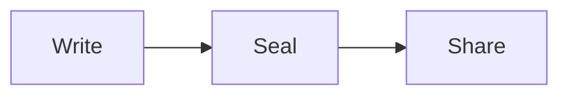

# Welcome to Sealdown

Write Markdown on the left and see it here. When it's ready, press **Share**: seal a fixed copy, encrypted in your browser, or open a live document to edit with others.

> [!TIP]
> This is a sample. Select all and start typing to make it yours.

## Diagrams, right in the text

## And the rest of Markdown

- [x] Tables, task lists, footnotes and callouts
- [x] Math, like $e^{i\pi} + 1 = 0$
- [ ] Your first sealed link

| Link | Who can read it |
|---|---|
| Sealed | Whoever has the link (and the password, if you set one) |
| Live | Edit link to collaborate, read link to follow along |
