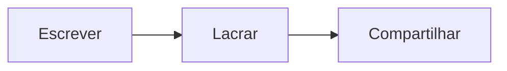

# Boas-vindas ao Sealdown

Escreva Markdown à esquerda e veja o resultado aqui. Quando estiver pronto, toque em **Compartilhar**: lacre uma cópia fixa, cifrada no seu navegador, ou abra um documento vivo para editar com outras pessoas.

> [!TIP]
> Isto é um exemplo. Selecione tudo e comece a digitar para fazer o seu.

## Diagramas no próprio texto

## E o resto do Markdown

- [x] Tabelas, listas de tarefas, notas de rodapé e avisos
- [x] Matemática, como $e^{i\pi} + 1 = 0$
- [ ] Seu primeiro link lacrado

| Link | Quem pode ler |
|---|---|
| Lacrado | Quem tiver o link (e a senha, se você definir uma) |
| Vivo | Link de edição para colaborar, link de leitura para acompanhar |
